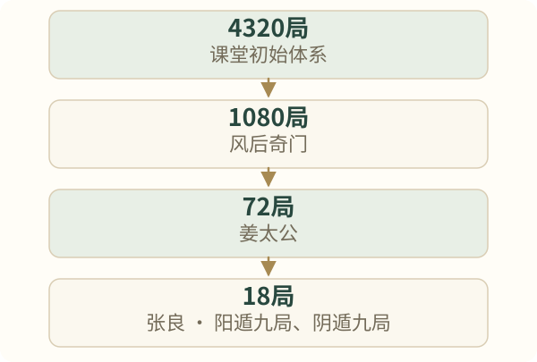
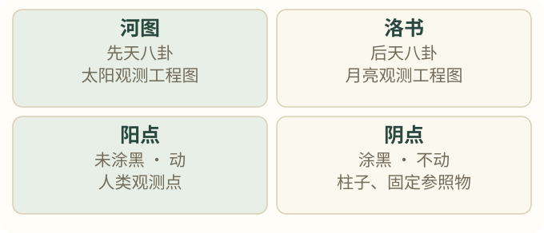
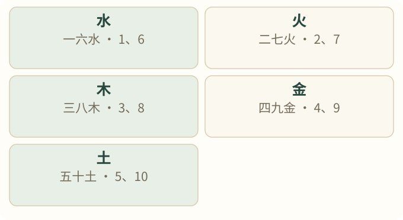
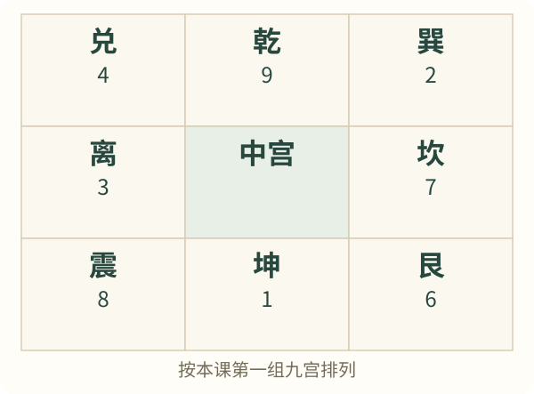
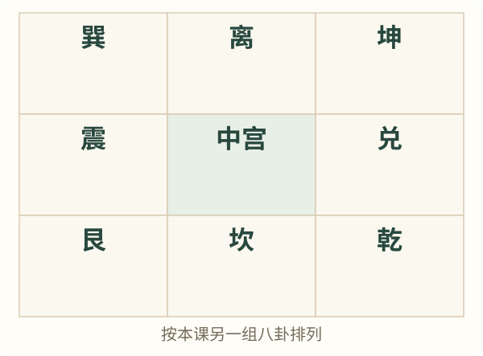
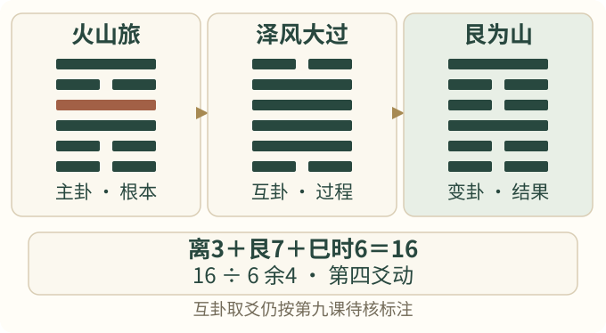
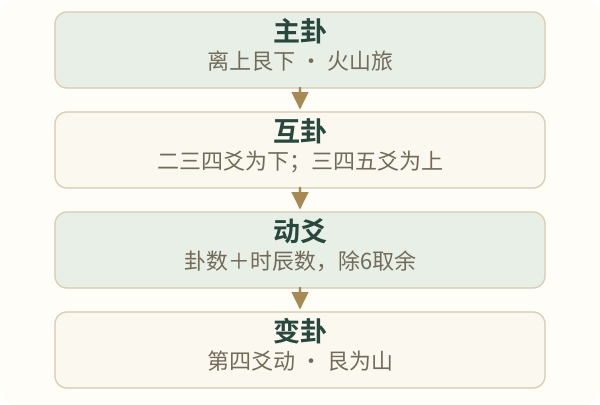
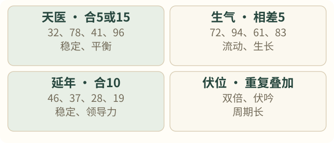
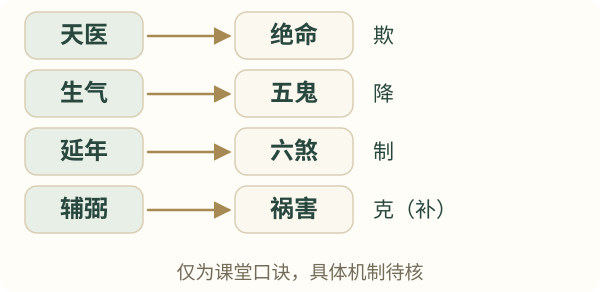
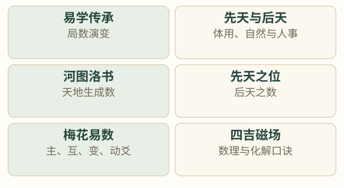

# 第九课｜易经：先后天八卦、梅花易数与四吉磁场

> 本课主线：易学传承 → 先后天八卦 → 河图洛书 → 卦位与数字 → 梅花易数 → 四吉磁场 → 四吉化解。
>
> 整理原则：保留老师课堂中的术语、观点和案例；课堂解释与已核实事实不混为一谈；未核对内容单独标注。

## 一、易学的传承与演变

### 1. 易学的传承与发展
课堂观点：易学并没有完全失传。部分方法由于不再适应当下社会形势和经济环境，经过不断优化和简化，核心理论与有效方法仍然流传。

### 2. 奇门遁甲的演变
| 体系 | 局数 | 课堂讲解 |
|---|---:|---|
| 奇门遁甲初始体系 | 4320局 | 课堂以一年4320个时辰作为解释 |
| 风后奇门 | 1080局 | 发现四组重复，简化为1080局 |
| 姜太公 | 72局 | 继续简化 |
| 张良 | 18局 | 阳遁九局、阴遁九局 |

演变路径：**4320局 → 1080局 → 72局 → 18局**。课堂将其概括为去除重复、简化体系、保留有效理论与方法。

### 3. 连山易、归藏易与先后天八卦
| 易学体系 | 课堂对应 | 主要特征 |
|---|---|---|
| 连山易 | 艮 | 原始易学，探索自然 |
| 归藏易 | 坤 | 原始易学，探索自然 |
| 先天八卦 | 伏羲 | 完整认识自然，研究天地规律 |
| 后天八卦 | 周文王、周易 | 社会制度、人事应用、农耕社会 |

课堂演变主线：**探索自然 → 完整认识自然 → 建立社会制度与人事应用。**

## 二、先天八卦与后天八卦

### 1. 先天八卦：自然与宇宙
- 代表自然、宇宙和天地运行规律。
- 研究不以人的意志为转移的自然规律。
- 偏向静态观察，强调认识自然本身。
- 是易学理论的基础。

### 2. 后天八卦：人事与社会
- 代表人为、人事和社会活动。
- 以动态视角观察万物变化。
- 强调人的主观能动性。
- 主要用于计算、判断和实际应用。

### 3. 先天与后天的关系
| 先天 | 后天 |
|---|---|
| 体 | 用 |
| 因 | 果 |
| 静 | 动 |
| 自然 | 人事 |
| 混沌 | 演变结果 |
| 天地规律 | 社会应用 |

**先天为体，后天为用。** 先天提供根本理论，后天进行具体应用；先天研究自然规律，后天将天地规律应用于社会和人事。

### 4. 先后天之间的对应关系
- 先天与后天之间存在对应、通气关系，可以相互参照，属于更高阶的应用。
- 课堂提出：先天理论可以用于检验后天判断。如果某种后天判断在先天理论中找不到支撑，就可以对其提出质疑。
- 先天侧重自然因素，后天侧重社会人事，将天地规律与人的活动联系起来。

### 5. 体用思想的历史类比
课堂借用以下历史概念帮助理解体用思想：
- 中学为体，西学为用。
- 师夷长技以制夷。
- 洋务运动。

核心：保留根本，学习和运用具体方法。

## 三、河图、洛书与天地生成之数

### 1. 河图与洛书
课堂讲法：河出图，洛出书；先天八卦来源于河图，后天八卦来源于洛书。

老师将河图洛书解释为古代观测星象的工程图：
| 名称 | 课堂解释 | 观测对象 |
|---|---|---|
| 河图 | 古代天文观测工程图 | 太阳 |
| 洛书 | 古代天文观测工程图 | 月亮 |

### 2. 阴阳点与观测原理
- 涂黑的点属阴，未涂黑的点属阳。
- 课堂解释中，阳点代表人类的观测点，阴点代表观测时使用的柱子或参照物。
- 课堂表述：**阳点要动，阴点不动。**
- 通过观测点和固定参照物研究天体运行。

### 3. 天道左旋，地道右旋
课堂用“天道左旋，地道右旋”解释天道与地道不同的运动方向。

### 4. 天地生成之数
核心概念：天生地成。以水为例：天一生水，地六成之。

| 五行 | 对应数字 | 记忆口诀 |
|---|---|---|
| 水 | 1、6 | 一六水 |
| 火 | 2、7 | 二七火 |
| 木 | 3、8 | 三八木 |
| 金 | 4、9 | 四九金 |
| 土 | 5、10 | 五十土 |

记忆：**一六水、二七火、三八木、四九金、五十土。** 河图洛书、阴阳和天地生成数，是后续认识卦位及磁场数字关系的基础。

## 四、先天之位，后天之数

### 1. 核心概念
**先天之位，后天之数。** 通过先天八卦的位置对应后天数字，再寻找不同磁场之间的数理规律。

### 2. 课件九宫第一组排列
| 兑 4 | 乾 9 | 巽 2 |
|---|---|---|
| 离 3 | 中宫 | 坎 7 |
| 震 8 | 坤 1 | 艮 6 |

### 3. 课件另一组八卦排列
| 巽 | 离 | 坤 |
|---|---|---|
| 震 | 中宫 | 兑 |
| 艮 | 坎 | 乾 |

### 4. 先天卦位对应数字
| 卦 | 数字 | 卦 | 数字 |
|---|---:|---|---:|
| 兑 | 4 | 乾 | 9 |
| 巽 | 2 | 离 | 3 |
| 坎 | 7 | 震 | 8 |
| 坤 | 1 | 艮 | 6 |

### 5. 三大吉磁场的数理规律
**天医：合五或十五**
- 3＋2＝5
- 7＋8＝15
- 4＋1＝5
- 9＋6＝15

**生气：相差五**
- 7－2＝5
- 9－4＝5
- 6－1＝5
- 8－3＝5

**延年：合十**
- 4＋6＝10
- 3＋7＝10
- 2＋8＝10
- 1＋9＝10

### 6. 九宫数理推导方法
1. 先确定先天八卦的位置。
2. 找到对应的后天数字。
3. 根据不同磁场的规律进行数字连线。
4. 通过相加、相减，寻找对应的磁场结构。

## 五、梅花易数：主卦、互卦、变卦

### 1. 三卦的基本含义
| 卦象 | 代表含义 | 判断重点 |
|---|---|---|
| 主卦 | 根本 | 事情的基本状态 |
| 互卦 | 过程 | 事情的发展与经过 |
| 变卦 | 结果 | 事情最终的发展方向 |

记忆：**主卦看根本，互卦看经过，变卦看结果。**

### 2. 课堂起卦案例：火山旅
课堂案例：早上9点半，一位美女从东北方来，老师据此取卦。

**第一步：确定主卦**
- 上卦取离，下卦取艮，形成火山旅卦。

**第二步：确定互卦**
- 主卦第二、三、四爻组成下卦。
- 主卦第三、四、五爻组成上卦。
- 课堂记录得到泽风大过，代表事情的发展经过。

**第三步：计算动爻**
- 先天卦数：离为3，艮为7，3＋7＝10。
- 时辰取数：早上9点半属于巳时，巳时对应数字6。
- 合计：3＋7＋6＝16。
- 一卦有六爻，16÷6＝2余4，因此第四爻动。

**第四步：确定变卦**
- 火山旅第四爻变化。
- 上卦离变为艮，下卦艮不变，形成艮为山。

### 3. 课堂断卦
艮为山，象义为“止”。老师认为，无论这位女子所问何事，都可以从艮为止的象义进行判断。

### 4. 完整起卦流程
**火山旅（主卦） → 泽风大过（互卦） → 16除以6余4 → 第四爻动 → 艮为山（变卦）。**

记忆重点：卦数与时辰数相加，除以6取余数确定动爻；主卦看根本、互卦看发展、变卦看结果。

## 六、四吉磁场及其数字规律

### 1. 四吉磁场总览
| 磁场 | 数字组合 | 数理规律 | 核心特点 |
|---|---|---|---|
| 天医 | 32、78、41、96 | 合5或15 | 稳定、平衡 |
| 生气 | 72、94、61、83 | 相差5 | 流动、生长 |
| 延年 | 46、37、28、19 | 合10 | 稳定、领导力 |
| 伏位 | 相同力量叠加 | 重复、双倍 | 伏吟、周期长 |

### 2. 天医磁场
**数字规律：合五或十五。**
- 3＋2＝5；7＋8＝15；4＋1＝5；9＋6＝15。
- 课堂认为，天医数字连接呈平行四边形结构，体现稳定与平衡。
- 数字5代表中庸之道，象征中正、平衡、不偏不倚；课堂认为后天数字呈5的倍数关系时，磁场较为稳定。

**主要特点**
- 稳定、平衡、中正。
- 主财富与健康。
- 主信仰，与善良有关。
- 课堂认为天医因善良也容易受人欺骗。

**应用方法**
- 天医宜静不宜动，不主张催运。
- 可以摆放葫芦、聚宝盆。
- 天医位置用作厨房也可以。

**课堂特别提醒：** 老师提到寅午戌、18年、夏天或立春与被骗钱的情况有关，具体对应关系尚待进一步核对。

记忆：**天医＝合五或十五＝稳定、平衡、财富、健康。**

### 3. 生气磁场
**数字规律：相差五。**
- 7－2＝5；9－4＝5；6－1＝5；8－3＝5。

**本质与特点**
- 生生不息，能量持续流动，不断向上生长。
- 动性强，不停流动、持续成长、不断进步和升级。

**应用方向**
- 催官、催文昌、催学业、催事业。
- 推动个人成长和发展。

记忆：**生气＝相差五＝流动、生长、升级。**

### 4. 延年磁场
**数字规律：合十。**
- 4＋6＝10；3＋7＝10；2＋8＝10；1＋9＝10。
- 课堂以“合十为美、十全十美、内外双吉”解释其数理，象征极致稳定。

**主要特点**
- 极致稳定，既能用又能催。
- 全才、领导力强、气场大。
- 老师称之为“帝王之相”。

**应用方向**
- 事业：催官的重要选择，体现领导力、主导力，适合成为核心人物。
- 婚姻：课堂认为可以催婚、催子，与早婚、较早生育有关。
- 居住：课堂表述“谁住延年，谁是核心”；住在延年位置的人容易成为家庭中的核心人物。

记忆：**延年＝合十＝稳定、领导力、催官、催婚、催子。**

### 5. 伏位磁场
**核心本质：两种相同力量叠加。**
- 具有双倍、两个、重复的能量特点，与伏吟有关。

**主要特点**
- 两种力量叠加，重复、双倍。
- 事情推进周期较长，进展慢、阻力较大。

**伏位与气口**
课堂强调：门是气口，是人员进出的地方，门的能量最大。

伏位位置的门口需要：
1. 保持通畅。
2. 保持活跃。
3. 保持干净。
4. 不宜堵塞。

记忆：**伏位＝重复叠加＝伏吟、双倍、周期长。**

## 七、四吉磁场的化解关系

### 1. 四吉与四凶的对应
| 四吉 | 对应四凶 | 课堂口诀 |
|---|---|---|
| 天医 | 绝命 | 天医欺绝命 |
| 生气 | 五鬼 | 生气降五鬼 |
| 延年 | 六煞 | 延年制六煞 |
| 辅弼（伏位） | 祸害 | 辅弼克（补）祸害 |

### 2. 课堂化解口诀
**天医欺绝命；生气降五鬼；延年制六煞；辅弼克（补）祸害。**

### 3. 待进一步学习
- 为什么四吉可以化解对应的四凶？
- 四吉与四凶之间具体存在什么数理关系？
- 化解的作用机制是什么？
- 不同空间和不同应用场景，是否存在使用区别？

## 八、本课知识总结与待核对内容

### 1. 核心知识速记
| 知识模块 | 核心内容 |
|---|---|
| 易学演变 | 4320局→1080局→72局→18局 |
| 先后天关系 | 先天为体，后天为用 |
| 河图洛书 | 先天对应河图，后天对应洛书（课堂讲法） |
| 五行生成数 | 一六水、二七火、三八木、四九金、五十土 |
| 先天之位 | 兑4、乾9、巽2、离3、坎7、震8、坤1、艮6 |
| 梅花易数 | 主卦看根本、互卦看经过、变卦看结果 |
| 天医 | 合五或十五 |
| 生气 | 相差五 |
| 延年 | 合十 |
| 伏位 | 双倍叠加、伏吟 |
| 四吉化解 | 天医欺绝命、生气降五鬼、延年制六煞、辅弼克（补）祸害 |

### 2. 课堂待核对内容
以下暂时保留老师的课堂讲法，不擅自替换为其他流派解释或补成定论。

1. 奇门遁甲4320局与一年4320个时辰之间的具体关系。
2. 河图洛书作为古代天文观测工程图的具体依据，以及太阳、月亮的观测解释。
3. 天医磁场与寅午戌、18年、夏天、立春及被骗钱之间的对应关系。
4. 四吉化解四凶的具体数理原理。
5. 梅花易数案例中互卦泽风大过的取卦过程，建议对照课堂原图再次核对。
