# 第十一课｜五鬼、祸害、六煞磁场与应期调和

## 一、本课知识总览

本课主要认识五鬼、祸害、六煞三种磁场，学习应期及主动运用，并区分大场、小场和人场的处理原则。

## 二、五鬼磁场

### 本位及性格（天）
- 本位离卦，正南，阴火。
- 课件核心：变、乱、多。
- 口述补充：变化多端、神秘莫测、捉摸不透、定不下来；聪明、鬼点子多、思维活跃。
- 人物取象：赵高。

### 行为（地）：以课件分类为准
- 鬼压床、长期多梦、失眠、精神分裂。
- 婚姻不幸福、多欲、暴躁、不明火（结果页另写“无明火”）。
- 花样多（卧室）；犯小人或自为小人、忤逆、说谎。
- 妇科、男性；字幕提到男性下丹田问题，具体病症未明。
- 口述补充：口舌、意外、火灾、噩梦、小人缠身、家中闹鬼、女性妇科炎症；表面一套背后一套；五鬼运财、财来财去。
- 以上是课程传统取象，不是医学诊断、疾病原因或现实事件预测。

### 结果（人）：课件补充
- 供神不宜取五鬼位，老师以“阴性因素”解释。
- 五鬼干扰严重的课堂取象：躁动、无明火。
- 睡五鬼位：课堂区分正直者招小人、意志不定者易成为两面人。
- 灵感工作者宜用已经调整过的五鬼，例如设计、策划、平面设计。
- 生气降五鬼。

## 三、祸害磁场

### 本位及性格（天）
- 本位坤卦，西南，阴土。
- 课件核心：内虚、自卑、嘴。
- 口述补充：孤独、不自信、极度自卑；内虚却吹嘘自己强大。
- 人物取象：苏大强、祥林嫂。

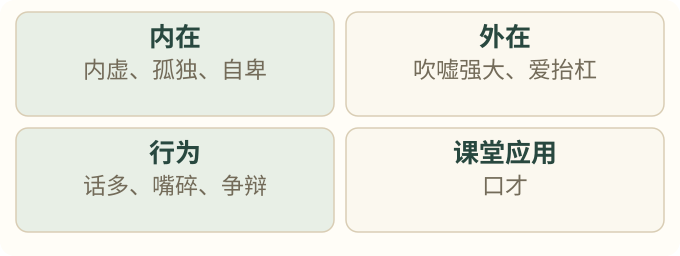

### 行为（地）
- 话多、嘴碎、杠精、无理争三分、得理不饶人。
- 口舌是非、孤寡、贫穷、自甘堕落、疾病缠身、牢狱。
- 口述补充：爱叨叨、抬杠、嘴强王者、身体不好、虚弱、诉讼。

### 结果（人）
- 卧室在祸害：课堂取象为慢性病、亚健康。
- 家中有药罐子，痴迷于“＊＊品”（截图原词遮蔽，不猜测）。
- 睡祸害：课堂取象为孩子先天体弱、先天性疾病。
- 课件另列“口才”，未进一步说明具体使用方法。
- 疾病及先天发育不由房间磁场决定，上述仅作为课程观点记录。

## 四、六煞磁场

### 本位及性格（天）
- 本位坎卦，正北，阴水。
- 课件核心：内心沉迷，表面轻浮。
- 课堂关键词：扭、反吟；口述概括“作、花、浪”。
- 口述补充：内心固执、自我矛盾、缺爱、追求浪漫、执着于美好；白月光、朱砂痣。
- 人物取象：潘金莲及老师举出的其他人物例子（仅作课堂比喻，不据此评价现实个人）。

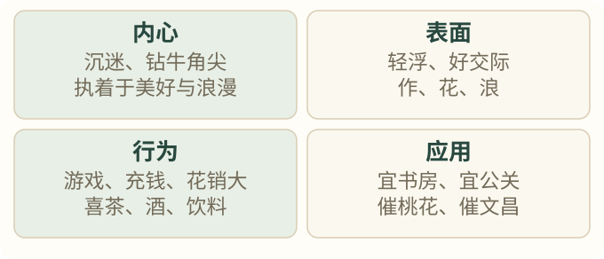

### 行为（地）
- 抑郁、钻牛角尖、易沉迷（上瘾、花销大）。
- 好交际，喜茶、酒、饮料；小产、人口不宁。
- 孩子：打游戏、充钱。
- 成年：课件列早恋、招桃花、婚姻反复。
- 自杀、水患、思虑重与肠道问题的课堂取象。
- 口述补充：轻浮、酗酒、好色、不孝、中毒而死等传统取象。
- 不可将上述象义用于判断抑郁、流产、自杀风险或其他医学及安全问题。

### 结果（人）
- 宜书房、宜公关。
- 催桃花，老师强调不要沉迷、不要恋爱脑；口述另提催文昌。
- 六煞年、六煞婚：课件强调稳胎及化解。这是传统说法，孕期风险及处理应依据医学评估。
- 女性睡六煞：执着于美好与浪漫，与男性关系时好时坏。
- 口述补充：男性睡六煞，取象为打牌、喝酒、花钱；夫妻合婚或同睡六煞，老师强调关注婚育及关系反复。
- 厨房是六煞：课堂取象为一家人气质比较好；厨房是整体的奠基力量。
- 延年压得住六煞。

## 五、三种磁场综合比较

| 维度 | 五鬼 | 祸害 | 六煞 |
|---|---|---|---|
| 本位 | 离 | 坤 | 坎 |
| 方位 | 正南 | 西南 | 正北 |
| 五行 | 阴火 | 阴土 | 阴水 |
| 天·性格（课件） | 变、乱、多 | 内虚、自卑、嘴 | 内心沉迷，表面轻浮 |
| 地·行为概括 | 多欲、暴躁、反复 | 话多、争辩、口舌 | 沉迷、花销、感情反复 |
| 人·应用取象 | 灵感工作者宜用已调整的五鬼 | 口才 | 宜书房、公关、催桃花 |
| 课堂记忆 | 变乱多 | 内虚、自卑、嘴 | 作花浪 |

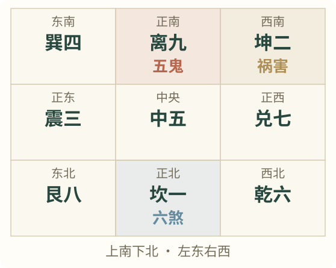

磁场本位仅为课程取象，并非固定方位对所有人都构成同一种磁场。

## 六、应期：相位与理法

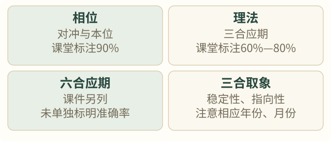

| 关系 | 判断依据 | 课件所述准确率 |
|---|---|---|
| 相位 | 对冲与本位 | 90% |
| 理法 | 三合应期 | 60%—80% |
| 六合应期 | 课件另列，口述与理法一并提及 | 未单独标明 |

以上百分比为老师课件中的陈述，非经独立科学验证的预测准确率。

### 相位
- 子午相对、卯酉相对；课堂联系形家风水。
- 对冲与本位的完整推演方法待补。

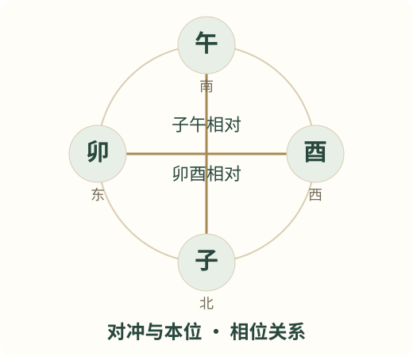

### 理法
- 三合应期；课件用三角形示意稳定性、指向性。
- 五鬼属火，寅午戌年、寅午戌月为课堂例子。
- 六合应期亦列于课件，具体算法待补。

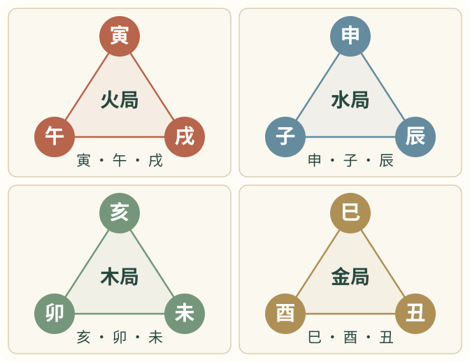

## 七、各磁场的三合应期

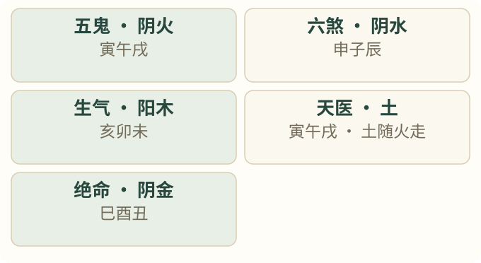

| 磁场 | 三合应期 | 课堂关注点 |
|---|---|---|
| 五鬼（阴火） | 寅午戌 | 暴躁、变化、不稳定 |
| 六煞（阴水） | 申子辰 | 感情反复、内心抑郁、花销大 |
| 生气（阳木） | 亥卯未 | 生气流年的亥、卯、未月，课堂取象为事业起色 |
| 天医（土） | 寅午戌 | 土随火走 |
| 绝命（阴金） | 巳酉丑 | 急躁、冲突、急功近利 |

- 注意三合月份。五鬼例子尤其提到寅、午、戌年中的寅、午、戌月。
- 补充课件案例：人与流年形成生气磁场，生气属木，关注亥、卯、未月；老师以事业起色为例说明吉磁场的应期。
- 八大磁场完整应期对照见课后作业第一题及第二题。

## 八、磁场的主动运用

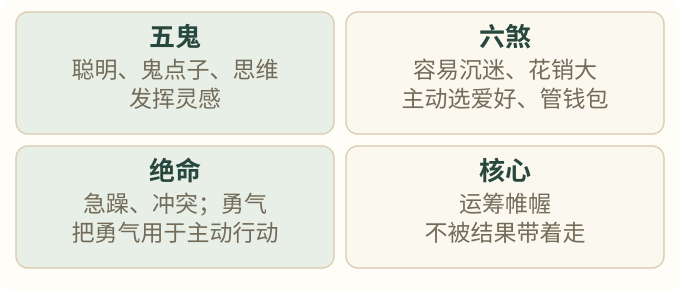

- 五鬼：聪明、鬼点子、思维变化，可发挥灵感。
- 六煞：在申子辰关注钱包、花销和沉迷，主动选择爱好。
- 绝命：课堂提醒巳酉丑注意驾驶、出行、与人冲突，避免急躁、急功近利。绝命也给人勇气，可主动做自己想做的事。
- 现实出行及安全决定应依赖实际路况、身体和其他客观条件，而非磁场预测。
- 课堂原话：注意的三合月份，其他月份扬长避短。应期月份重点关注相应磁场的性质，其他月份也可以发挥长处、避免短处。
- 课堂核心：运筹帷幄，有则改之无则加勉，不要被结果带着走。

## 九、大场、小场、人场

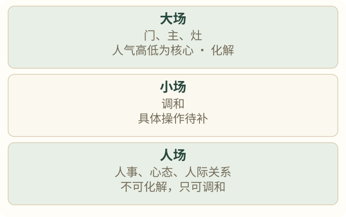

| 层次 | 本课课堂记录 | 处理原则 |
|---|---|---|
| 大场 | 门主灶，以人气的高低为核心 | 化解 |
| 小场 | 具体划分与操作待补 | 调和 |
| 人场 | 人与流年；人与人的关系、人事、心态 | 不可化解，只可调和 |

- 补充课件明确将人与流年的关系列在人场之下；例如人与流年形成生气，属木，应期关注亥、卯、未月。
- 人场处理人与人的关系，重在人事和心态；注意三合月份，其他月份扬长避短。
- 补充课件以弧线连接大场与小场，分别标注化解、调和。具体联动操作未详细记录，不推定其空间包含关系。

## 十、本课磁场化解关系

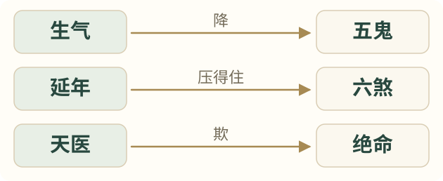

- 生气降五鬼。
- 延年压得住六煞。
- 天医欺绝命。
- 大场化解，小场调和，人场只可调和。

## 十一、核心知识结构与课堂记忆

- 五鬼：变、乱、多。
- 祸害：内虚、自卑、嘴。
- 六煞：内心沉迷，表面轻浮；作、花、浪；扭、反吟。
- 相位：对冲与本位；理法：三合与六合应期。
- 土随火走；注意的三合月份，其他月份扬长避短。
- 人场不可化解，只可调和。
- 运筹帷幄，有则改之无则加勉，不要被结果带着走。

## 十二、资料来源与待核事项

- 依据2026年11月26日第十一课当天听课文字及12张课堂照片整理；不混入之前课程。
- 天、地、人分类以最新课件为准，口述内容另外标示。图解为原创学习辅助，并非课件复制。
- 祸害结果页的“＊＊品”原文遮蔽，暂不猜测；“口才”具体应用、相位及六合完整推演、小场具体方法待补。
- 课件限制个人学习和传播，原始照片不公开上传。健康、婚育、心理、灾祸及应期准确率等仅为传统课堂取象，不代表经科学验证的因果或预测规律。

## 十三、课后作业第一题｜八大磁场完整知识树

题目：构建八个磁场的知识树状图，包括五行、卦位、代表人物、天（性格）、地（行为）、人（结果）、应期，并体会象意根源。

本专题综合第九课四吉磁场、第十课天地人与三元命、第十一课三凶及应期，另参照第六课星曜对应资料。与前十二章单课笔记分开归档，方便长期复习。人物只作为课堂象意例子；传统术数取象不作为对现实个人的评价、疾病诊断、婚育判断或事件预测。

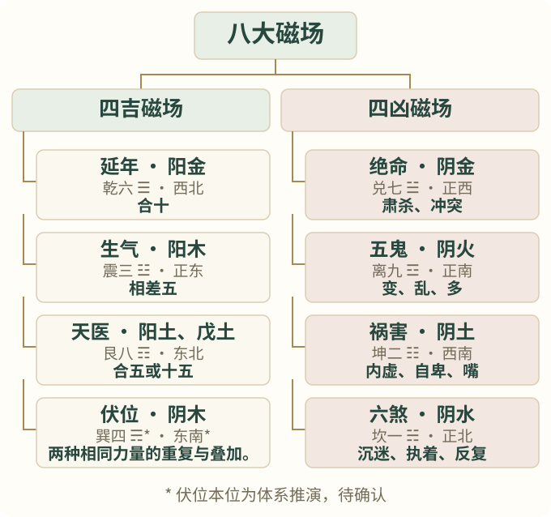

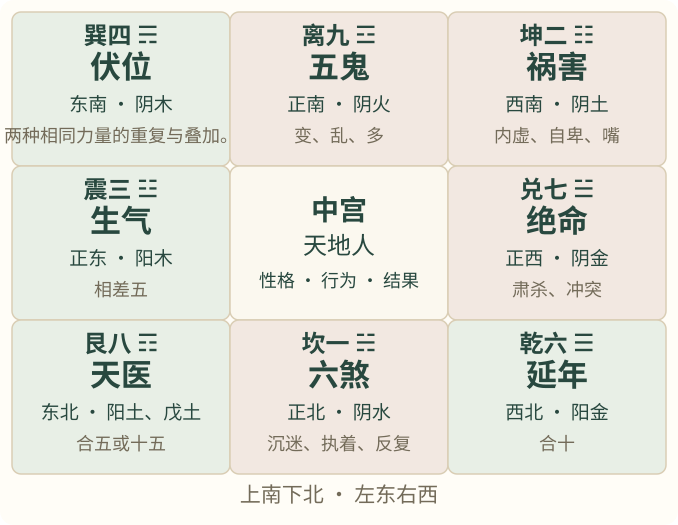

### 八磁场基本属性与应期对照

| 磁场 | 本位与方位 | 五行 | 星曜 | 象意根源 | 三合应期 |
|---|---|---|---|---|---|
| 延年 | 乾六 ☰·西北 | 阳金 | 武曲 | 合十，极致稳定、权威与领导力。 | 巳酉丑 |
| 生气 | 震三 ☳·正东 | 阳木 | 贪狼 | 相差五，生生不息、流动、生发与成长。 | 亥卯未 |
| 天医 | 艮八 ☶·东北 | 阳土、戊土 | 巨门 | 合五或十五，中正、稳定、平衡、善良与信仰。 | 寅午戌（土随火走） |
| 伏位 | 巽四 ☴·东南 | 阴木 | 辅弼 | 两种相同力量的重复与叠加。 | 亥卯未 |
| 绝命 | 兑七 ☱·正西 | 阴金 | 破军 | 肃杀、冲突，爪形与金木相争；第十一课补充勇气。 | 巳酉丑 |
| 五鬼 | 离九 ☲·正南 | 阴火 | 廉贞 | 变、乱、多，不稳定；也可取聪明、鬼点子与灵感。 | 寅午戌 |
| 祸害 | 坤二 ☷·西南 | 阴土 | 禄存 | 内虚、自卑、嘴；内虚外强为整理理解。 | 寅午戌 |
| 六煞 | 坎一 ☵·正北 | 阴水 | 文曲 | 沉迷、执着、反复，内心与表面不一致。 | 申子辰 |

伏位本位及八磁场三合应期按已确认的学习口径统一呈现。伏位完整天地人分类及代表人物仍缺资料。后天本位不等于某方位对所有人皆吉或凶。

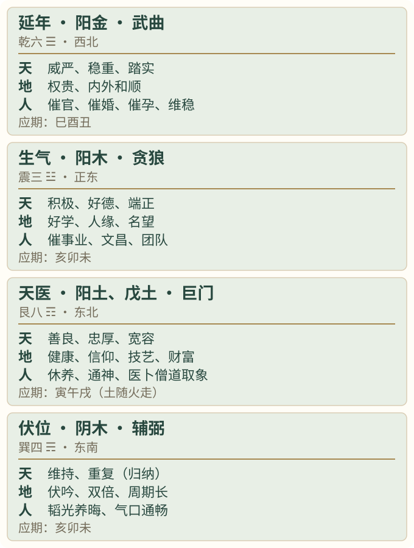

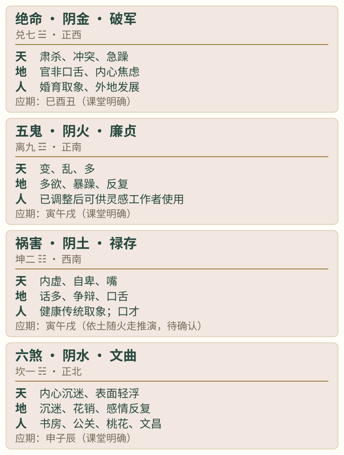

### 1、延年（四吉）
- 五行：阳金。
- 卦位：乾六 ☰，西北。
- 星曜：武曲。
- 代表人物：秦始皇、汉武帝、李世民、武则天。
- 天（性格）：威严、稳重、踏实；自我。
- 地（行为）：取得权贵、内外和顺皆兴旺、高高在上、早婚、人丁兴旺；过重则自以为是、不容挑战、打架。
- 人（结果）：催官、催婚、催孕、维稳。
- 应期：巳酉丑。
- 象意根源：合十，极致稳定、权威与领导力。
- 学习理解（非课件原话）：稳定也有失衡的一面，过重可能表现为自我、不容挑战。

### 2、生气（四吉）
- 五行：阳木。
- 卦位：震三 ☳，正东。
- 星曜：贪狼。
- 代表人物：周总理、优秀的部门经理、导师。
- 天（性格）：积极向上、好德之心、德行端正。
- 地（行为）：好学、有文化、人缘好、有名望；过重则好高骛远、眼高手低、过于清高、死要面子。
- 人（结果）：催事业、催文昌、催团队；第九课另列催官、催学业。
- 应期：亥卯未。
- 象意根源：相差五，生生不息、流动、生发与成长。
- 学习理解（非课件原话）：向上发展需要落实到行动，不能只停留在追求更高目标。

### 3、天医（四吉）
- 五行：阳土、戊土。
- 卦位：艮八 ☶，东北。
- 星曜：巨门。
- 代表人物：张三丰、张仲景。
- 天（性格）：善良、忠厚、宽容。
- 地（行为）：身心健康、与宗教产生联系、有信仰、有技艺、有财富、出医卜僧道。第九课提到善良容易受骗。
- 人（结果）：睡天医休息好、精力易恢复；生病时休养、吃药、保健品、住院床位的传统取象；通神、供神；厨卧天医取象为至少一人为医卜僧道。第九课强调宜静不宜动、不主张催运。
- 应期：寅午戌（土随火走）。
- 象意根源：合五或十五，中正、稳定、平衡、善良与信仰。
- 学习理解（非课件原话）：善良与宽容不等于没有边界。

### 4、伏位（四吉）
- 五行：阴木。
- 卦位：巽四 ☴，东南。
- 星曜：辅弼。
- 代表人物：尚无明确课堂人物例子。
- 天（性格）：完整课件分类未见；由相同力量叠加可理解为维持、重复（整理归纳）。
- 地（行为）：第九课：伏吟、重复、双倍、两个、周期长、进展慢、阻力大；天地人具体归类为整理归纳。
- 人（结果）：第十课流年取象：韬光养晦；第九课伏位门口宜干净、通畅、活跃，不宜堵塞。完整结果分类待确认。
- 应期：亥卯未。
- 象意根源：两种相同力量的重复与叠加。
- 学习理解（非课件原话）：相同力量的积累不等于快速发展；完整天地人分类仍待课件。

### 5、绝命（四凶）
- 五行：阴金。
- 卦位：兑七 ☱，正西。
- 星曜：破军。
- 代表人物：白起、残暴的将士、讲义气的黑道大哥。
- 天（性格）：肃杀、冲突、急躁、急功近利。
- 地（行为）：对外冲突灾祸、官非口舌、短寿、不治之症；对内缺乏安全感、焦虑、子女缘薄、肝郁；家庭关系一般、子女外地发展。均为课堂取象。
- 人（结果）：催孕：阴阳相合、女儿、易流、忌双绝命；绝命婚易头胎女儿、不宜催婚；睡绝命卧取象为子女缘薄、外出工作。
- 应期：巳酉丑。
- 象意根源：肃杀、冲突，爪形与金木相争；第十一课补充勇气。
- 学习理解（非课件原话）：将勇气用于主动行动，避免急躁、冲突和急功近利。

### 6、五鬼（四凶）
- 五行：阴火。
- 卦位：离九 ☲，正南。
- 星曜：廉贞。
- 代表人物：赵高。
- 天（性格）：变、乱、多；变化多端、神秘莫测、捉摸不透。
- 地（行为）：鬼压床、长期多梦、失眠、精神分裂；婚姻不幸福、多欲、暴躁、无明火、花样多（卧室）、犯小人或自为小人、忤逆、说谎；妇科、男性下丹田取象；口述另有口舌、意外、火灾、财来财去。
- 人（结果）：神明不供五鬼；干扰严重者躁动、无明火；睡五鬼位，正直者招小人、意志不定者易成为两面人；灵感工作者宜用已经调整过的五鬼。
- 应期：寅午戌。
- 象意根源：变、乱、多，不稳定；也可取聪明、鬼点子与灵感。
- 学习理解（非课件原话）：将变化的力量用于思考和创作，而不是任其发展为混乱。

### 7、祸害（四凶）
- 五行：阴土。
- 卦位：坤二 ☷，西南。
- 星曜：禄存。
- 代表人物：苏大强、祥林嫂。
- 天（性格）：内虚、自卑、嘴；孤独、不自信、极度自卑。
- 地（行为）：话多、嘴碎、杠精、无理争三分、得理不饶人、口舌是非、孤寡、贫穷、自甘堕落、疾病缠身、牢狱；口述另有诉讼、吹嘘强大。
- 人（结果）：卧室在祸害取象为慢性病、亚健康；家中有药罐子、痴迷于“＊＊品”（原文遮蔽）；睡祸害取象为孩子先天体弱、先天性疾病；课件另列口才。
- 应期：寅午戌。
- 象意根源：内虚、自卑、嘴；内虚外强为整理理解。
- 学习理解（非课件原话）：可以关注内在的自信与语言表达；口才的具体应用待老师补充。

### 8、六煞（四凶）
- 五行：阴水。
- 卦位：坎一 ☵，正北。
- 星曜：文曲。
- 代表人物：潘金莲；口述另举现实人物，仅作课堂比喻。
- 天（性格）：内心沉迷、表面轻浮；扭、反吟，执着、自我矛盾；口述概括作、花、浪。
- 地（行为）：抑郁、钻牛角尖、易沉迷（上瘾、花销大）、好交际、喜茶酒饮料、小产、人口不宁；孩子打游戏充钱；早恋、招桃花、婚姻反复；自杀、水患及思虑重与肠道问题等课堂取象。
- 人（结果）：宜书房、宜公关、催桃花（不要沉迷、不要恋爱脑）；口述另提催文昌；六煞年、六煞婚注意稳胎及化解；女性睡六煞执着于美好与浪漫，关系反复；男性睡六煞打牌、喝酒、花钱；厨房六煞取象为一家人气质较好。
- 应期：申子辰。
- 象意根源：沉迷、执着、反复，内心与表面不一致。
- 学习理解（非课件原话）：主动选择有益的爱好，管理消费，不任由自己沉迷。

### 四吉与四凶的对应关系

| 四吉 | 四凶 | 课堂口诀 |
|---|---|---|
| 天医 | 绝命 | 天医欺绝命 |
| 生气 | 五鬼 | 生气降五鬼 |
| 延年 | 六煞 | 延年制六煞（第十一课口述：延年压得住六煞） |
| 辅弼（伏位） | 祸害 | 辅弼克（补）祸害 |

### 象意根源的理解

不只记忆吉凶，而是辨别每种磁场的性质：延年重稳定，生气重生发，天医重平衡，伏位重叠加，绝命重肃杀，五鬼重变化，祸害重内虚与口舌，六煞重沉迷与反复。上述概括属于跨课复习归纳；老师所述“百断百灵”属于课程主张，并无独立科学验证。

## 十四、课后作业第二题｜两种应期判断与七星运用

题目：风水理论中的两种应期判断方法是什么？在七星理论中如何运用？

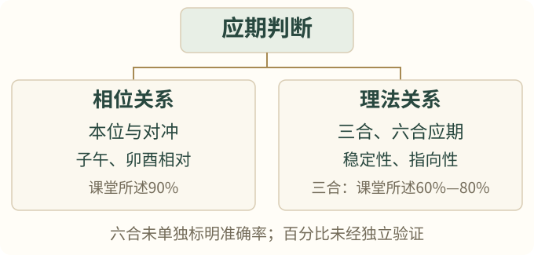

### 一、两种应期判断方法

- 相位关系：通过本位与对冲关系判断应期。课堂所述90%，例如子午相对、卯酉相对；联系形家风水。完整推演步骤尚待补充。
- 理法关系：通过三合、六合判断应期。三合具有稳定性、指向性，课堂所述60%—80%；六合没有单独标明准确率及具体算法。
- 上述百分比为课堂说法，非独立验证数据。

### 二、在七星理论中的运用

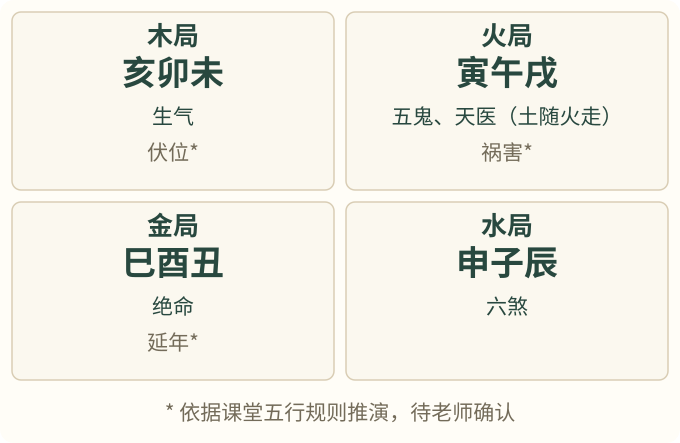

| 五行 | 三合应期 | 对应磁场 |
|---|---|---|
| 木 | 亥卯未 | 生气、伏位 |
| 火 | 寅午戌 | 五鬼 |
| 土随火走 | 寅午戌 | 天医、祸害 |
| 金 | 巳酉丑 | 延年、绝命 |
| 水 | 申子辰 | 六煞 |

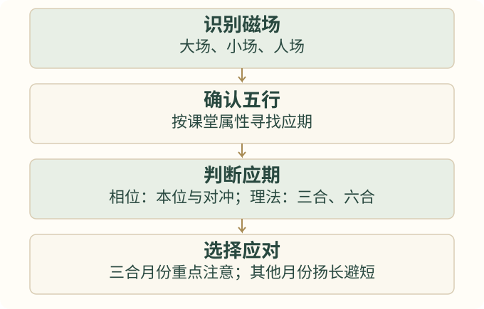

先判断磁场，再认识其五行属性，根据课堂应期规则关注对应年份、月份，并结合具体场的性质选择处理方向。

- 五鬼：寅午戌，注意躁动、变化、多欲，发挥聪明才智、思维与灵感。
- 六煞：申子辰，关注感情反复、沉迷、消费过大，管住钱包，主动选择爱好。
- 生气：亥卯未，人与流年形成生气的课堂案例取象为事业起色，主动把握发展机会。
- 天医：土随火走，取寅午戌。
- 绝命：巳酉丑，避免急躁、冲突、急功近利，主动运用勇气。出行安全仍应依据现实情况，而非磁场预测。

### 三、不同场的处理

| 场 | 内容 | 处理原则 |
|---|---|---|
| 大场 | 门、主、灶，以人气高低为核心 | 化解 |
| 小场 | 具体划分和操作待补充 | 调和 |
| 人场 | 人与流年、人与人、人事、心态 | 不可化解，只可调和 |

课堂原话：注意的三合月份，其他月份扬长避短。

### 四、作业理解（整理稿）

学习应期并非被动等待结果，而是通过认识磁场的象意，主动调整行为。六煞的沉迷可以引导至有益爱好，五鬼的变化可用于思考和创作，绝命的肃杀与冲突也可以转化为面对问题的勇气。认识根源比单纯记忆吉凶更重要。

课堂核心：运筹帷幄，有则改之，无则加勉，不要被结果带着走。

### 综合作业来源与待核

- 第一题综合第九至十一课笔记，第六课星曜对应；第二题以第十一课听课文字和12张课堂截图为依据。
- 伏位代表人物及天地人完整分类；相位及六合应期完整推演；小场具体操作、祸害口才具体应用待确认。
- 本作业新增内容是跨课综合复习，不改变前十二章原有单课整理。学习理解是作业归纳稿，非老师原话。
