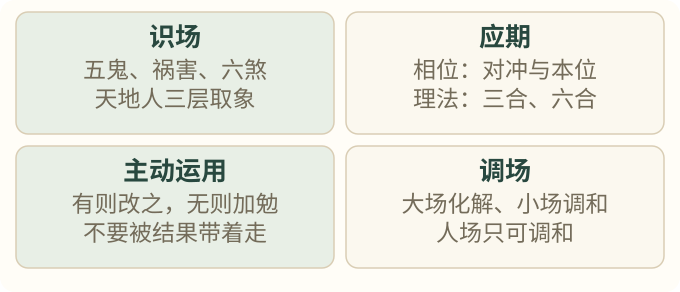
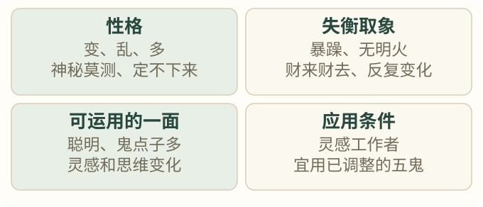
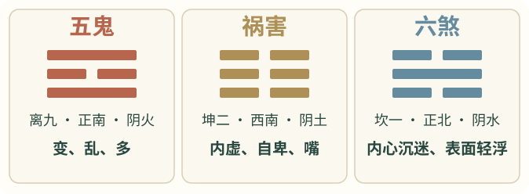
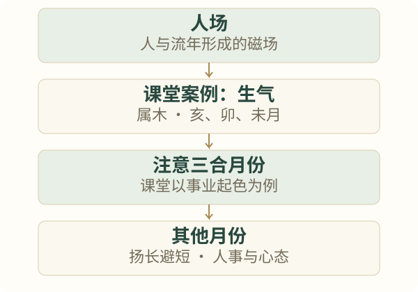

# 第十一课｜五鬼、祸害、六煞磁场与应期调和

## 一、本课知识总览

本课主要认识五鬼、祸害、六煞三种磁场，学习应期及主动运用，并区分大场、小场和人场的处理原则。

## 二、五鬼磁场

### 本位及性格（天）
- 本位离卦，正南，阴火。
- 课件核心：变、乱、多。
- 口述补充：变化多端、神秘莫测、捉摸不透、定不下来；聪明、鬼点子多、思维活跃。
- 人物取象：赵高。

### 行为（地）：以课件分类为准
- 鬼压床、长期多梦、失眠、精神分裂。
- 婚姻不幸福、多欲、暴躁、不明火（结果页另写“无明火”）。
- 花样多（卧室）；犯小人或自为小人、忤逆、说谎。
- 妇科、男性；字幕提到男性下丹田问题，具体病症未明。
- 口述补充：口舌、意外、火灾、噩梦、小人缠身、家中闹鬼、女性妇科炎症；表面一套背后一套；五鬼运财、财来财去。
- 以上是课程传统取象，不是医学诊断、疾病原因或现实事件预测。

### 结果（人）：课件补充
- 供神不宜取五鬼位，老师以“阴性因素”解释。
- 五鬼干扰严重的课堂取象：躁动、无明火。
- 睡五鬼位：课堂区分正直者招小人、意志不定者易成为两面人。
- 灵感工作者宜用已经调整过的五鬼，例如设计、策划、平面设计。
- 生气降五鬼。

## 三、祸害磁场

### 本位及性格（天）
- 本位坤卦，西南，阴土。
- 课件核心：内虚、自卑、嘴。
- 口述补充：孤独、不自信、极度自卑；内虚却吹嘘自己强大。
- 人物取象：苏大强、祥林嫂。

### 行为（地）
- 话多、嘴碎、杠精、无理争三分、得理不饶人。
- 口舌是非、孤寡、贫穷、自甘堕落、疾病缠身、牢狱。
- 口述补充：爱叨叨、抬杠、嘴强王者、身体不好、虚弱、诉讼。

### 结果（人）
- 卧室在祸害：课堂取象为慢性病、亚健康。
- 家中有药罐子，痴迷于“＊＊品”（截图原词遮蔽，不猜测）。
- 睡祸害：课堂取象为孩子先天体弱、先天性疾病。
- 课件另列“口才”，未进一步说明具体使用方法。
- 疾病及先天发育不由房间磁场决定，上述仅作为课程观点记录。

## 四、六煞磁场

### 本位及性格（天）
- 本位坎卦，正北，阴水。
- 课件核心：内心沉迷，表面轻浮。
- 课堂关键词：扭、反吟；口述概括“作、花、浪”。
- 口述补充：内心固执、自我矛盾、缺爱、追求浪漫、执着于美好；白月光、朱砂痣。
- 人物取象：潘金莲及老师举出的其他人物例子（仅作课堂比喻，不据此评价现实个人）。

### 行为（地）
- 抑郁、钻牛角尖、易沉迷（上瘾、花销大）。
- 好交际，喜茶、酒、饮料；小产、人口不宁。
- 孩子：打游戏、充钱。
- 成年：课件列早恋、招桃花、婚姻反复。
- 自杀、水患、思虑重与肠道问题的课堂取象。
- 口述补充：轻浮、酗酒、好色、不孝、中毒而死等传统取象。
- 不可将上述象义用于判断抑郁、流产、自杀风险或其他医学及安全问题。

### 结果（人）
- 宜书房、宜公关。
- 催桃花，老师强调不要沉迷、不要恋爱脑；口述另提催文昌。
- 六煞年、六煞婚：课件强调稳胎及化解。这是传统说法，孕期风险及处理应依据医学评估。
- 女性睡六煞：执着于美好与浪漫，与男性关系时好时坏。
- 口述补充：男性睡六煞，取象为打牌、喝酒、花钱；夫妻合婚或同睡六煞，老师强调关注婚育及关系反复。
- 厨房是六煞：课堂取象为一家人气质比较好；厨房是整体的奠基力量。
- 延年压得住六煞。

## 五、三种磁场综合比较

| 维度 | 五鬼 | 祸害 | 六煞 |
|---|---|---|---|
| 本位 | 离 | 坤 | 坎 |
| 方位 | 正南 | 西南 | 正北 |
| 五行 | 阴火 | 阴土 | 阴水 |
| 天·性格（课件） | 变、乱、多 | 内虚、自卑、嘴 | 内心沉迷，表面轻浮 |
| 地·行为概括 | 多欲、暴躁、反复 | 话多、争辩、口舌 | 沉迷、花销、感情反复 |
| 人·应用取象 | 灵感工作者宜用已调整的五鬼 | 口才 | 宜书房、公关、催桃花 |
| 课堂记忆 | 变乱多 | 内虚、自卑、嘴 | 作花浪 |

磁场本位仅为课程取象，并非固定方位对所有人都构成同一种磁场。

## 六、应期：相位与理法

| 关系 | 判断依据 | 课件所述准确率 |
|---|---|---|
| 相位 | 对冲与本位 | 90% |
| 理法 | 三合应期 | 60%—80% |
| 六合应期 | 课件另列，口述与理法一并提及 | 未单独标明 |

以上百分比为老师课件中的陈述，非经独立科学验证的预测准确率。

### 相位
- 子午相对、卯酉相对；课堂联系形家风水。
- 对冲与本位的完整推演方法待补。

### 理法
- 三合应期；课件用三角形示意稳定性、指向性。
- 五鬼属火，寅午戌年、寅午戌月为课堂例子。
- 六合应期亦列于课件，具体算法待补。

## 七、各磁场的三合应期

| 磁场 | 三合应期 | 课堂关注点 |
|---|---|---|
| 五鬼（阴火） | 寅午戌 | 暴躁、变化、不稳定 |
| 六煞（阴水） | 申子辰 | 感情反复、内心抑郁、花销大 |
| 生气（阳木） | 亥卯未 | 生气流年的亥、卯、未月，课堂取象为事业起色 |
| 天医（土） | 寅午戌 | 土随火走 |
| 绝命（阴金） | 巳酉丑 | 急躁、冲突、急功近利 |

- 注意三合月份。五鬼例子尤其提到寅、午、戌年中的寅、午、戌月。
- 补充课件案例：人与流年形成生气磁场，生气属木，关注亥、卯、未月；老师以事业起色为例说明吉磁场的应期。
- 祸害、延年、伏位的具体应期未在本次资料中明确，暂不补写。

## 八、磁场的主动运用

- 五鬼：聪明、鬼点子、思维变化，可发挥灵感。
- 六煞：在申子辰关注钱包、花销和沉迷，主动选择爱好。
- 绝命：课堂提醒巳酉丑注意驾驶、出行、与人冲突，避免急躁、急功近利。绝命也给人勇气，可主动做自己想做的事。
- 现实出行及安全决定应依赖实际路况、身体和其他客观条件，而非磁场预测。
- 课堂原话：注意的三合月份，其他月份扬长避短。应期月份重点关注相应磁场的性质，其他月份也可以发挥长处、避免短处。
- 课堂核心：运筹帷幄，有则改之无则加勉，不要被结果带着走。

## 九、大场、小场、人场

| 层次 | 本课课堂记录 | 处理原则 |
|---|---|---|
| 大场 | 门主灶，以人气的高低为核心 | 化解 |
| 小场 | 具体划分与操作待补 | 调和 |
| 人场 | 人与流年；人与人的关系、人事、心态 | 不可化解，只可调和 |

- 补充课件明确将人与流年的关系列在人场之下；例如人与流年形成生气，属木，应期关注亥、卯、未月。
- 人场处理人与人的关系，重在人事和心态；注意三合月份，其他月份扬长避短。
- 补充课件以弧线连接大场与小场，分别标注化解、调和。具体联动操作未详细记录，不推定其空间包含关系。

## 十、本课磁场化解关系

- 生气降五鬼。
- 延年压得住六煞。
- 天医欺绝命。
- 大场化解，小场调和，人场只可调和。

## 十一、核心知识结构与课堂记忆

- 五鬼：变、乱、多。
- 祸害：内虚、自卑、嘴。
- 六煞：内心沉迷，表面轻浮；作、花、浪；扭、反吟。
- 相位：对冲与本位；理法：三合与六合应期。
- 土随火走；注意的三合月份，其他月份扬长避短。
- 人场不可化解，只可调和。
- 运筹帷幄，有则改之无则加勉，不要被结果带着走。

## 十二、资料来源与待核事项

- 依据2026年11月26日第十一课当天听课文字及12张课堂照片整理；不混入之前课程。
- 天、地、人分类以最新课件为准，口述内容另外标示。图解为原创学习辅助，并非课件复制。
- 祸害结果页的“＊＊品”原文遮蔽，暂不猜测；“口才”具体应用、相位及六合完整推演、小场具体方法待补。
- 课件限制个人学习和传播，原始照片不公开上传。健康、婚育、心理、灾祸及应期准确率等仅为传统课堂取象，不代表经科学验证的因果或预测规律。
